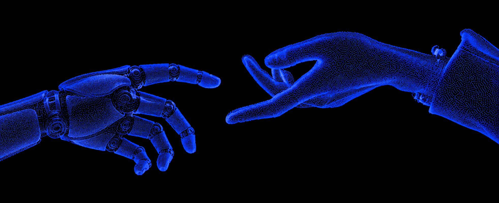

# H I L L &nbsp;&nbsp; P A T E L

**AI Engineer · Agentic Systems &amp; Infrastructure** 
CloudRedux · Pune, India

[Portfolio](https://stifler.in) &nbsp;·&nbsp; [LinkedIn](https://www.linkedin.com/in/hill-patel-stifler7/) &nbsp;·&nbsp; [CV on request](mailto:hillpatel.0710@gmail.com?subject=CV%20request)

---

I build LLM applications and tools that help AI agents remember, recover, and work
with reliable context. My work spans **AI engineering and forward-deployed engineering**:
understanding customer workflows, designing solutions, and turning requirements into
working software.

## §01 &nbsp; Selected Public Work

| Project | What it does |
| :--- | :--- |
| **[memex](https://github.com/STiFLeR7/memex)** | Keeps codebase context current for AI coding agents. |
| **[Cairn](https://github.com/STiFLeR7/Cairn)** | Helps agents recover after crashes and context loss. |
| **[Pinocchio](https://github.com/STiFLeR7/pinocchio)** | Checks coding-agent completion claims against session evidence. |
| **[Waypoint](https://github.com/STiFLeR7/waypoint-mcp)** | Keeps a shared project log across AI coding tools. |

[More public projects →](https://github.com/STiFLeR7?tab=repositories)

## §02 &nbsp; Open-Source Contributions

**[Tencent/teamai-cli](https://github.com/Tencent/teamai-cli)** —
[18 merged pull requests](https://github.com/Tencent/teamai-cli/pulls?q=is%3Apr+is%3Amerged+author%3ASTiFLeR7)
as of November 2026, spanning Windows compatibility, agent initialization, and developer tooling.

## §03 &nbsp; Working With

**AI:** LLMs · RAG · MCP · LangGraph · Google ADK 
**Build:** Python · TypeScript · FastAPI · React · PostgreSQL · Neo4j 
**Operate:** Docker · GitHub Actions · OpenTelemetry · GCP · Cloudflare Workers

---

B.Tech in Artificial Intelligence &amp; Machine Learning, NIMS University · 2026 
[Get in touch](mailto:hillpatel.0710@gmail.com) · Building the systems around the model.
